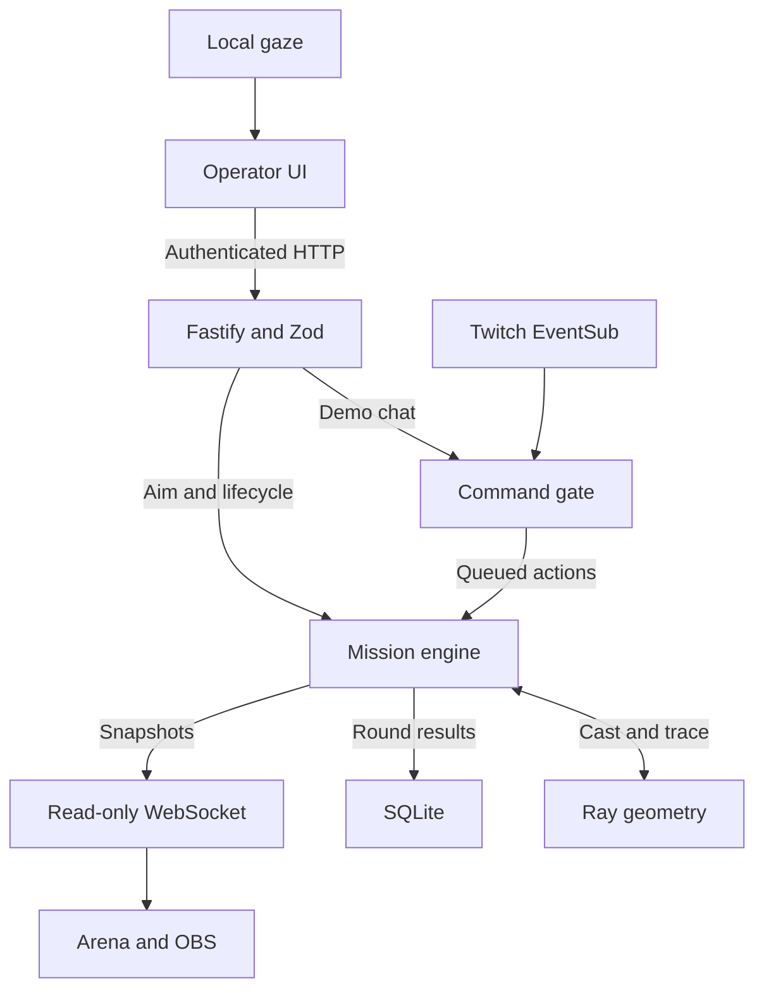
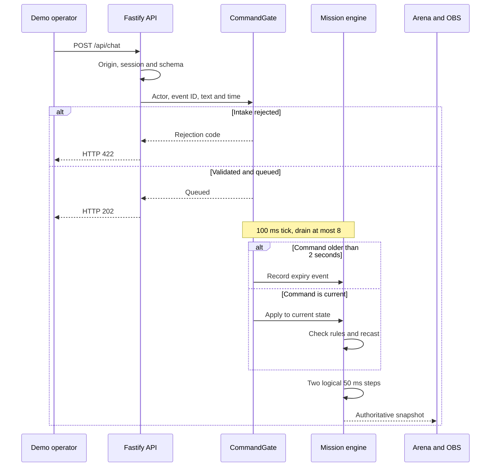
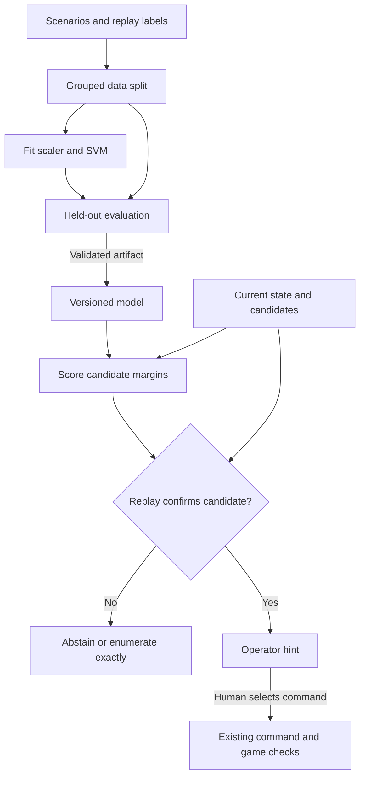

# Tw1tchCh4tX · PRISM X

**Your eyes. Their moves. One mission.** A Twitch community arena where the streamer aims a light beam, chat rotates mirrors, and viewers vote to contain simulated cyber threats. The application combines deterministic ray geometry, a server-owned mission state machine, optional local gaze estimation, and an OBS overlay.


**Implementation boundary:** the arena, command protections, Twitch adapter, gaze adapter, and persistence described below exist in this repository. The [support vector machine design](#proposed-support-vector-boundary-advisor) is a mathematical research proposal for explaining the feasibility of candidate mirror moves. There is currently **no SVM trainer, trained model, inference endpoint, or SVM-driven gameplay**. Proposed equations do not describe shipped behavior or measured performance.

[Quick start](#run-the-local-demo) · [Architecture](#implemented-architecture) · [Physics](#mathematics-of-the-implemented-arena) · [SVM proposal](#proposed-support-vector-boundary-advisor) · [Boundary distances](#closest-boundary-and-critical-points) · [Verification](#verification-and-operating-limits)

## Run the local demo

Use Node **24.15+ within the 24.x line**, npm, and a modern desktop browser.

```bash
git clone https://github.com/victrvondoom/Tw1tchCh4tX.git
cd Tw1tchCh4tX
npm ci
cp .env.example .env
npm run dev
```

Open **http://localhost:5173** and choose **Play demo**. No Twitch account, API key, webcam, or paid service is needed. Keep the default loopback binding for this mode. Fastify runs on port 3000; Vite proxies HTTP and WebSocket requests during development.

For the first mission, disable mouse aim, select **Aim 0°**, send `!rotate A -15`, and vote **quarantine** during the phishing wave. Hold the reflected beam on the target for 0.8 seconds; the round completes after the defense window closes. Each simulated browser operator is one voter.

## Implemented architecture

One Node process owns one shared arena. The browser displays snapshots and submits intentions; the server decides geometry, command acceptance, charges, votes, score, and round completion. SQLite retains anonymous results, while active rounds, sessions, OAuth tokens, and protection caches are held in memory.



Camera frames and landmarks remain in the browser; only the resulting aim angle reaches the server. Twitch chat enters through the same command gate as authenticated demo chat. The overlay cannot issue control commands. There is no runtime OpenAI API call; Codex was used as a development tool.

| Responsibility            | Source of truth                                                                                                  | Implemented behavior                                                                                |
| ------------------------- | ---------------------------------------------------------------------------------------------------------------- | --------------------------------------------------------------------------------------------------- |
| HTTP, sessions, snapshots | [`apps/server/src/app.ts`](apps/server/src/app.ts)                                                               | Authenticated mutations, exact-origin checks, read-only WebSocket, bounded clients and backpressure |
| Chat intake               | [`commands.ts`](apps/server/src/security/commands.ts)                                                            | Allowlist, event age, deduplication, cooldown, token bucket, queue expiry                           |
| Mission transitions       | [`engine.ts`](apps/server/src/game/engine.ts)                                                                    | Aim, rotations, charging, final votes, threats, scoring                                             |
| Ray geometry              | [`packages/physics/src/index.ts`](packages/physics/src/index.ts)                                                 | Closest intersection, reflection, absorbers, target contact, bounded tracing                        |
| Contracts and missions    | [`packages/shared/src/index.ts`](packages/shared/src/index.ts)                                                   | Runtime Zod schemas, types, three authored levels                                                   |
| Twitch transport          | [`bridge.ts`](apps/server/src/twitch/bridge.ts)                                                                  | OAuth and EventSub read-chat integration with reconnect handling                                    |
| Gaze                      | [`useGaze.ts`](apps/web/src/features/gaze/useGaze.ts), [`estimator.ts`](apps/web/src/features/gaze/estimator.ts) | Local iris features, five calibration points, smoothing, explicit camera stop                       |
| Results                   | [`store.ts`](apps/server/src/db/store.ts)                                                                        | Last 100 anonymous results and separate demo/Twitch leaderboards                                    |

### Command acceptance is a two-stage decision

An HTTP `202` means a command was queued. It does not mean a mirror was rotated. The game can reject queued work because the round is no longer playing, the mirror does not exist in that mission, or the move budget was exhausted before application.



Accepted non-aim controls clear the pending queue. Replay memory remains. A delayed timer advances only 100 ms of logical time per callback; it does not catch up with elapsed wall time. Deterministic game progression and network delivery latency are therefore different quantities.

## Mathematics of the implemented arena

These equations express the operations in the physics and game source. Coordinates are arena pixels with positive x to the right and positive y downward. Angles are clockwise from positive x; mirror angles describe segment tangents. The simulation models geometric reflection, not diffraction, polarization, or refractive prism optics.

### Ray–segment intersections and the nearest obstruction

Let a ray start at $\mathbf{o}$ with unit direction $\mathbf{d}$, and let a surface span endpoints $\mathbf{a},\mathbf{b}$. Define the two-dimensional scalar cross product by $[\mathbf{p},\mathbf{q}]=p_xq_y-p_yq_x$. Solving the two parametric lines gives

$$
\begin{aligned}
\mathbf{r}(t)&=\mathbf{o}+t\mathbf{d},
&\mathbf{s}(u)&=\mathbf{a}+u(\mathbf{b}-\mathbf{a}),\\
D&=[\mathbf{d},\mathbf{b}-\mathbf{a}],
&t&=\frac{[\mathbf{a}-\mathbf{o},\mathbf{b}-\mathbf{a}]}{D},
&u&=\frac{[\mathbf{a}-\mathbf{o},\mathbf{d}]}{D},\\
\mathcal I&=\{j:|D_j|\ge\varepsilon,\ t_j>\varepsilon,
\ -\varepsilon\le u_j\le1+\varepsilon,\ t_j<R\},
&j^\star&\in\operatorname*{arg\,min}_{j\in\mathcal I}t_j.
\end{aligned}
$$

Here $R$ is the remaining distance budget and $\varepsilon=10^{-7}$. Only the closest eligible surface terminates the current visible segment. Equal-distance ties retain the first surface in the supplied array because the implementation replaces a hit only for a strictly smaller distance. If no surface qualifies, the segment extends to the remaining budget.

For a mirror tangent $\boldsymbol{\tau}=(\mathbf{b}-\mathbf{a})/\|\mathbf{b}-\mathbf{a}\|_2$, reflection and the next origin are

$$
\begin{aligned}
\widetilde{\mathbf d}_{k+1}
  &=\left(2\boldsymbol{\tau}_k\boldsymbol{\tau}_k^\top-I\right)\mathbf d_k,\\
\mathbf d_{k+1}
  &=\frac{\widetilde{\mathbf d}_{k+1}}{\|\widetilde{\mathbf d}_{k+1}\|_2},\\
\mathbf o_{k+1}
  &=\mathbf o_k+t_k^\star\mathbf d_k+10\varepsilon\mathbf d_{k+1},\\
R_{k+1}&=R_k-t_k^\star-10\varepsilon.
\end{aligned}
$$

The small origin shift avoids immediately hitting the same surface again and is charged against the distance budget. An absorbing surface ends the trace without reflection. Defaults permit 12 reflections and a total path budget of 2,400 pixels; the returned trace may contain 13 segments.

### Target contact, physical clearance, and dwell time

For a visible segment from $\mathbf p$ to $\mathbf q$, target center $\mathbf c_j$, and radius $r_j$, the implementation evaluates a clamped projection:

$$
\begin{aligned}
\mathbf v&=\mathbf q-\mathbf p,\\
\lambda_j&=\operatorname{clip}_{[0,1]}
\left(\frac{(\mathbf c_j-\mathbf p)^\top\mathbf v}
{\max(\varepsilon,\mathbf v^\top\mathbf v)}\right),\\
d_j(\mathbf p,\mathbf q)&=\|\mathbf p+\lambda_j\mathbf v-\mathbf c_j\|_2,\\
I_j&=\mathbf1\left\{\min_{(\mathbf p,\mathbf q)\in\text{visible trace}}
d_j(\mathbf p,\mathbf q)\le r_j\right\}.
\end{aligned}
$$

A useful **derived diagnostic**, not a stored runtime field, is signed optical clearance $g_j=r_j-\min d_j$. Positive clearance means the trace penetrates the target disk, zero means tangency, and negative clearance means a miss. Occluded extensions do not count. This clearance is measured in pixels and must not be confused with an SVM feature-space margin.

For an uncaptured target, the engine updates charge $c_{j,k}$ in milliseconds:

$$
c_{j,k+1}=
\begin{cases}
\min(800,c_{j,k}+50),&I_{j,k}=1,\\
0,&I_{j,k}=0.
\end{cases}
\qquad
\text{capture when }c_{j,k+1}=800.
$$

A newly illuminated target needs 16 uninterrupted logical steps. One missed step resets its charge; a captured target stays captured. A geometric hit alone does not imply a mission win: the player must also survive and resolve all authored threat waves.

### Bounded intake and simulation work

The global command bucket has capacity 24 and replenishes at 12 tokens per second. At an intake attempt at wall-clock time $t_k$ in milliseconds, its refill is

$$
\widetilde B_k=\min\left(24,B_{k-1}+
\frac{12}{1000}\max(0,t_k-t_{k-1})\right).
$$

If $\widetilde B_k<1$, intake rejects the command; otherwise it spends one token before later cooldown/parser/queue checks. Passing this bucket does not guarantee admission. At most $\min(8,q_k)$ items are removed from queue depth $q_k$ per drain, including expired commands. Eight per 100 ms gives a nominal drain ceiling of 80 commands/s; the bucket limits sustained admitted traffic to 12/s under normal timing.

| Bound                        | Current value                            | Consequence                                     |
| ---------------------------- | ---------------------------------------- | ----------------------------------------------- |
| Per-actor cooldown           | 750 ms                                   | Limits repeated intake by one actor             |
| Pending command queue        | 64                                       | Intake rejects when full                        |
| Queue lifetime               | 2,000 ms                                 | Old commands expire at drain                    |
| Incoming event age tolerance | 120,000 ms                               | Stale or excessively future-dated events reject |
| Replay cache / actor cache   | 10,000 each                              | Bounded protection memory                       |
| Physics hard caps            | 64 reflections, 128 surfaces, 64 targets | Trace work remains bounded                      |
| WebSocket connections        | 64 total, 8 per IP                       | Snapshot fan-out is bounded                     |
| Socket buffered output       | 262,144 bytes                            | Slow consumers are disconnected                 |

With reflection cap $B$, $S$ surfaces, and $T$ targets, the brute-force tracer takes $O((B+1)(S+T))$ work and stores at most $B+1$ segments. These are algorithmic bounds, not measured latency claims.

## Proposed support vector boundary advisor

**Status: research design only.** The proposed feature would explain which legal mirror moves are predicted to sustain a target hit and how close those predictions are to changing. It would assist hints or an operator preview; it would not decide authentication, replace ray tracing, alter voting, or authorize commands.

For three small missions, direct enumeration and deterministic simulation are the reference baseline and may be sufficient. An SVM is justified only if experiments show useful ranking or explanation benefits for a larger scenario set.

### Define the prediction before choosing a kernel

Let $s$ be a complete simulator snapshot, $a=(m,\Delta\theta)$ a candidate rotation, and $j$ an uncaptured target. A reproducible scenario $\omega$ fixes future aim samples, other scheduled actions, threat votes, and a look-ahead horizon $H$ that is a multiple of 50 ms. The proposed offline label is

$$
\begin{aligned}
\mathcal A(s)&=\left\{(m,5k^\circ):
m\in\text{mirrors}(s),\ k\in\{-9,\ldots,-1,1,\ldots,9\},\right.\\
&\hspace{3em}\left.\text{phase}(s)=\text{playing},\ \text{moves}(s)<\text{moveLimit}(s)
\right\},\\
y(s,a,j,\omega)&=
\begin{cases}
+1,&a\in\mathcal A(s)\text{ and replay captures }j\text{ within }H\\
&\text{without losing through capture},\\
-1,&\text{otherwise}.
\end{cases}
\end{aligned}
$$

Training should focus on legal candidates; malformed messages and authorization failures already have exact rejection rules. The label describes a target-specific, scenario-specific outcome, not success under unknown future Twitch commands. A serialization/replay harness preserving private game fields and gate state would have to be added: the public snapshot is not a complete replay checkpoint, and SQLite summaries cannot reconstruct these labels.

A fixed-aim/no-new-command rollout answers a different question from a recorded jitter sequence or competing-chat replay. Version the scenario policy, target, and horizon with the dataset. For aggregated labels, explicitly state whether every scenario must succeed or a particular empirical success fraction must be exceeded.

### Feature construction and units

For a fixed mission family, an illustrative proposed feature vector is

$$
\begin{aligned}
\mathbf x=\Big[&
\sin\theta_e,\cos\theta_e,
\{\sin\theta_m,\cos\theta_m,\mu_m\}_{m=A,B,C},
\operatorname{onehot}(m_a),\Delta\theta/45^\circ,\\
&\{x_m/1000,y_m/600,\ell_m/1000\}_{m=A,B,C},
x_j/1000,y_j/600,r_j/1000,c_j/800,\\
&\frac{\text{moves remaining}}{\max(1,\text{move limit})},
\frac{\text{time remaining}}{\text{mission duration}},
\frac{\text{health}}{100},\frac{\text{defense charges}}{3},\\
&\frac{\text{queue depth}}{64},\frac{H}{\text{mission duration}},
\operatorname{onehot}(\text{mission}),
\operatorname{onehot}(\text{scenario policy})\Big]^\top,\\
z_k&=\frac{x_k-\mu_k^{\mathrm{train}}}
{\max(\sigma_k^{\mathrm{train}},\epsilon_s)}.
\end{aligned}
$$

Angles inside sine/cosine are converted to radians; $\mu_m$ is a mirror-presence mask, distinct from training mean $\mu_k^{\mathrm{train}}$. Missing mirror slots use a documented fill value and mask. Fit normalization on the training fold only; $\epsilon_s>0$ prevents division by zero. This is a candidate schema, not an existing API type.

Mission identity encodes only the authored layouts. Generalization to new obstacle geometry requires representing that geometry and testing unseen layouts. Private ballots and future action schedules also affect outcomes: either fix these variables or include a sufficient representation. Never infer feasibility by using post-outcome features.

An SVM distance in standardized features is dimensionless. It is not automatically an angular tolerance, time budget, or confidence probability. Those interpretations require explicit mappings and constraints.

### Proposed training and inference boundaries



Everything before the existing gate in this diagram is proposed. A model output carries its source round/revision and expires when that state changes. A selected command still passes normal intake and current game rules. Learning can prioritize candidates; execution remains server-authoritative.

### Cost-sensitive soft-margin objective

For labeled vectors $\{(\mathbf z_i,y_i)\}_{i=1}^{n}$ with both classes present, a positive-semidefinite kernel $K$, and feature map $\phi$ into a reproducing kernel Hilbert space $\mathcal H$, define

$$
\begin{aligned}
\min_{\mathbf w,b,\boldsymbol\xi}\quad
P(\mathbf w,b,\boldsymbol\xi)
&=\frac12\|\mathbf w\|_{\mathcal H}^{2}
  +\sum_{i=1}^{n}C_i\xi_i,\\
\text{subject to}\quad
y_i\big(\langle\mathbf w,\phi(\mathbf z_i)\rangle_{\mathcal H}+b\big)
&\ge1-\xi_i,\qquad \xi_i\ge0,\\
C_i&=C\,\omega_{y_i}\nu_i>0.
\end{aligned}
$$

Here $\omega_{y_i}$ controls class cost and $\nu_i$ is a documented sample weight. Increasing the cost on negative examples penalizes false feasible predictions more strongly, but does not guarantee their elimination. The intercept is unregularized. This is weighted hinge-loss C-SVC; a solver with squared hinge loss or a regularized intercept solves a different problem.

Eliminating slack yields the equivalent objective

$$
\min_{\mathbf w,b}
\frac12\|\mathbf w\|_{\mathcal H}^2+
\sum_{i=1}^{n}C_i
\max\!\left(0,1-y_i\left[\langle\mathbf w,\phi(\mathbf z_i)\rangle_{\mathcal H}+b\right]\right).
$$

The first term discourages a steep separating function; the second charges for margin violations. Choosing an RBF kernel is a hypothesis about nonlinear structure, not evidence that the learned frontier matches the physical one.

### Lagrangian, dual, and the meaning of a support vector

Introduce multipliers $\alpha_i,\beta_i\ge0$ for classification and nonnegative-slack constraints. The Lagrangian is

$$
\begin{aligned}
\mathcal L
&=\frac12\|\mathbf w\|_{\mathcal H}^{2}
+\sum_i C_i\xi_i
+\sum_i\alpha_i\left[1-\xi_i-y_i\left(\langle\mathbf w,\phi(\mathbf z_i)\rangle_{\mathcal H}+b\right)\right]
-\sum_i\beta_i\xi_i,\\
\nabla_{\mathbf w}\mathcal L=0
&\Longrightarrow \mathbf w=\sum_i\alpha_i y_i\phi(\mathbf z_i),\\
\partial_b\mathcal L=0
&\Longrightarrow \sum_i\alpha_i y_i=0,\\
\partial_{\xi_i}\mathcal L=0
&\Longrightarrow C_i-\alpha_i-\beta_i=0.
\end{aligned}
$$

Substitution gives the constrained quadratic dual and prediction function:

$$
\begin{aligned}
\max_{\boldsymbol\alpha}\quad D(\boldsymbol\alpha)
&=\sum_i\alpha_i-
\frac12\sum_i\sum_j\alpha_i\alpha_j y_i y_j K(\mathbf z_i,\mathbf z_j),\\
\text{subject to}\quad
0&\le\alpha_i\le C_i,\qquad \sum_i\alpha_i y_i=0,\\
f(\mathbf z)&=\sum_{i\in\mathcal S}\alpha_i y_i K(\mathbf z_i,\mathbf z)+b,
\qquad \mathcal S=\{i:\alpha_i>0\}.
\end{aligned}
$$

At an optimum, the Karush–Kuhn–Tucker conditions also require primal feasibility and complementary slackness:

$$
\begin{aligned}
\alpha_i\big[y_if(\mathbf z_i)-1+\xi_i\big]&=0,\\
(C_i-\alpha_i)\xi_i&=0,\\
y_if(\mathbf z_i)-1+\xi_i&\ge0,\qquad \xi_i\ge0.
\end{aligned}
$$

The convex soft-margin problem has strictly feasible points with sufficiently large positive slack. Its KKT conditions characterize global optima; a feasible primal/dual pair should have a small nonnegative gap $P-D$ within solver tolerance. This is an optimization check, not a generalization score.

| Multiplier regime | Exact-optimum implication | Interpretation                                    |
| ----------------- | ------------------------- | ------------------------------------------------- |
| $\alpha_i=0$      | $\xi_i=0$, $y_if_i\ge1$   | No direct term in the decision function           |
| $0<\alpha_i<C_i$  | $\xi_i=0$, $y_if_i=1$     | Free support vector on a canonical margin plane   |
| $\alpha_i=C_i$    | $y_if_i=1-\xi_i\le1$      | May be on the margin, inside it, or misclassified |

For a free support vector, $b=y_i-\sum_j\alpha_jy_jK(\mathbf z_j,\mathbf z_i)$; average consistent estimates to reduce numerical error. If none exists, recover an admissible intercept from KKT bounds or the solver's intercept computation. Do not divide by the count of an empty free-support-vector set.

Support vectors are **training constraints that influence the fitted separator**. They are not automatically gameplay turning points, stationary points of $f$, or the closest attainable control changes for a new state.

## Closest boundary and critical points

This section derives several different distances. Keeping them separate is essential to answering “how close can an action get to the boundary and still be performed?”

### Exact distance to the learned hyperplane in feature space

For $\|\mathbf w\|_{\mathcal H}>0$, the decision boundary is $f=0$, and the canonical training margin planes are $f=\pm1$. The kernel representation makes their geometry explicit:

$$
\begin{aligned}
\|\mathbf w\|_{\mathcal H}^{2}
&=\sum_i\sum_j\alpha_i\alpha_jy_iy_jK(\mathbf z_i,\mathbf z_j),\\
\rho(\mathbf z)
&=\frac{f(\mathbf z)}{\|\mathbf w\|_{\mathcal H}},
\qquad d_{\mathcal H}(\mathbf z,\{f=0\})=|\rho(\mathbf z)|,\\
\gamma_{\mathrm{canonical}}
&=\frac1{\|\mathbf w\|_{\mathcal H}},
\qquad \text{width between }f=-1\text{ and }f=1
=\frac2{\|\mathbf w\|_{\mathcal H}},\\
\phi_\perp(\mathbf z)
&=\phi(\mathbf z)-\frac{f(\mathbf z)}{\|\mathbf w\|_{\mathcal H}^{2}}\mathbf w.
\end{aligned}
$$

This projection is exact in the ambient feature space. For a nonlinear kernel, $\phi_\perp(\mathbf z)$ need not equal $\phi(\mathbf z')$ for any realizable input $\mathbf z'$. Consequently, $|f|/\|\mathbf w\|_{\mathcal H}$ is not generally the minimum pixel, degree, or input-feature change needed to cross a nonlinear boundary. Soft-margin samples can lie closer to $f=0$ than $1/\|\mathbf w\|$; the canonical margin is not the minimum observed sample distance.

### Exact closest point for a linear model and an explicit metric

Take $f(\mathbf z)=\mathbf w^\top\mathbf z+b$ and a symmetric positive-definite metric matrix $M$. Define $\|\boldsymbol\delta\|_M=(\boldsymbol\delta^\top M\boldsymbol\delta)^{1/2}$. To reach score threshold $\tau$, solve

$$
\begin{aligned}
\boldsymbol\delta^\star
&=\operatorname*{arg\,min}_{\boldsymbol\delta}
\frac12\boldsymbol\delta^\top M\boldsymbol\delta
\quad\text{subject to}\quad
\mathbf w^\top(\mathbf z+\boldsymbol\delta)+b=\tau,\\
\mathcal L_{\mathrm{proj}}(\boldsymbol\delta,\lambda)
&=\frac12\boldsymbol\delta^\top M\boldsymbol\delta
+\lambda\big(f(\mathbf z)+\mathbf w^\top\boldsymbol\delta-\tau\big),\\
M\boldsymbol\delta^\star+\lambda^\star\mathbf w&=0,\\
\boldsymbol\delta^\star
&=-\frac{f(\mathbf z)-\tau}{\mathbf w^\top M^{-1}\mathbf w}M^{-1}\mathbf w,\\
d_{M,\tau}(\mathbf z)
&=\frac{|f(\mathbf z)-\tau|}{\sqrt{\mathbf w^\top M^{-1}\mathbf w}}.
\end{aligned}
$$

Set $\tau=0$ for the classification boundary. A chosen $\tau>0$ defines a more conservative advisory threshold on the predicted feasible side; it is not necessarily the canonical $+1$ margin. For $f(\mathbf z)>\tau$, perturbations strictly smaller than $d_{M,\tau}$ cannot cross that score threshold in this linear model. Equality reaches it.

If only a linear subspace can change, write $\boldsymbol\delta=P\mathbf v$, with full-column-rank $P$, and define $G=P^\top MP$, $\mathbf h=P^\top\mathbf w$. Then

$$
\mathbf v^\star=
-\frac{f(\mathbf z)-\tau}{\mathbf h^\top G^{-1}\mathbf h}G^{-1}\mathbf h,
\qquad
d_{\mathrm{allowed}}=
\frac{|f(\mathbf z)-\tau|}{\sqrt{\mathbf h^\top G^{-1}\mathbf h}}.
$$

If $\mathbf h=0$ and $f(\mathbf z)\ne\tau$, the threshold is unreachable within that subspace. If already on the threshold, the distance is zero. A zero-weight classifier has no reachable threshold unless its constant score equals $\tau$.

### Worked numerical example

Use a deliberately synthetic two-feature classifier, not a trained result:

$$
\mathbf w=\begin{bmatrix}2\\-1\end{bmatrix},\quad
b=-0.4,\quad
\mathbf z=\begin{bmatrix}0.4\\0.1\end{bmatrix},\quad
M=\begin{bmatrix}4&0\\0&1\end{bmatrix}.
$$

Then $f(\mathbf z)=0.3$ and $\mathbf w^\top M^{-1}\mathbf w=2$. For $\tau=0$,

$$
\boldsymbol\delta^\star=
-\frac{0.3}{2}\begin{bmatrix}0.5\\-1\end{bmatrix}
=\begin{bmatrix}-0.075\\0.15\end{bmatrix},\qquad
f\!\left(\begin{bmatrix}0.325\\0.25\end{bmatrix}\right)=0,\qquad
d_{M,0}=\frac{0.3}{\sqrt2}\approx0.212132.
$$

The Euclidean closest-boundary distance is instead $0.3/\sqrt5\approx0.134164$, because it solves a different minimization problem. If only the second coordinate can change, the required displacement is $+0.3$, with metric distance $0.3$. For the positive threshold $\tau=0.2$, the unrestricted metric distance falls to $0.1/\sqrt2\approx0.070711$. None of these numbers is a probability or an angle in degrees.

### Nonlinear RBF boundaries: local estimates and conservative bounds

For $K(\mathbf z_i,\mathbf z)=\exp(-\gamma\|\mathbf z-\mathbf z_i\|_2^2)$ with $\gamma>0$, let $a_i=\alpha_i y_i$ and $\mathbf r_i=\mathbf z-\mathbf z_i$. Differentiating gives

$$
\begin{aligned}
f(\mathbf z)&=\sum_{i\in\mathcal S}a_i e^{-\gamma\|\mathbf r_i\|_2^2}+b,\\
\nabla f(\mathbf z)&=-2\gamma\sum_{i\in\mathcal S}
a_i e^{-\gamma\|\mathbf r_i\|_2^2}\mathbf r_i,\\
\nabla^2 f(\mathbf z)&=\sum_{i\in\mathcal S}
a_i e^{-\gamma\|\mathbf r_i\|_2^2}
\left(4\gamma^2\mathbf r_i\mathbf r_i^\top-2\gamma I\right),\\
d_{\mathrm{local},M,\tau}(\mathbf z)
&\approx\frac{|f(\mathbf z)-\tau|}
{\sqrt{\nabla f(\mathbf z)^\top M^{-1}\nabla f(\mathbf z)}}.
\end{aligned}
$$

The last expression is the distance to the **local linearization**, not an exact nonlinear level-set distance. It becomes unreliable with curvature, a large step, or a near-zero gradient. A stationary point satisfying $\nabla f=0$ need not lie on a boundary at all.

An explicit Euclidean Lipschitz upper bound follows by maximizing one kernel gradient:

$$
\begin{aligned}
\max_{r\ge0}2\gamma r e^{-\gamma r^2}
&=\sqrt{\frac{2\gamma}{e}},\\
\|\nabla f(\mathbf z)\|_2
&\le L:=\sqrt{\frac{2\gamma}{e}}
\sum_{i\in\mathcal S}|a_i|,\\
f(\mathbf z+\boldsymbol\delta)
&\ge f(\mathbf z)-L\|\boldsymbol\delta\|_2.
\end{aligned}
$$

When $f(\mathbf z)>\tau$ and $L>0$, every perturbation with norm strictly less than $(f(\mathbf z)-\tau)/L$ preserves $f>\tau$. This is a conservative lower bound on the distance to the model threshold, not the exact nearest boundary or a guarantee of physical feasibility. If the threshold is unreachable, its distance is infinite. If $L=0$, handle the constant function directly.

A local analysis may instead bound the Hessian operator norm by $H_f$ throughout an entire radius-$r$ ball. Taylor's remainder gives

$$
\begin{aligned}
f(\mathbf z+\boldsymbol\delta)
&\ge f(\mathbf z)-\|\nabla f(\mathbf z)\|_2r-\frac12H_fr^2,
\qquad \|\boldsymbol\delta\|_2\le r,\\
r_{\mathrm{cert}}
&=\frac{\sqrt{\|\nabla f(\mathbf z)\|_2^2+
2H_f(f(\mathbf z)-\tau)}-\|\nabla f(\mathbf z)\|_2}{H_f},
\quad H_f>0.
\end{aligned}
$$

The bound must hold throughout the resulting ball; evaluating the Hessian only at its center is insufficient. A globally valid, possibly loose RBF choice is $H_f=(2\gamma+4\gamma/e)\sum_i|a_i|$, from the triangle inequality and $\max_{r\ge0}r^2e^{-\gamma r^2}=1/(\gamma e)$. With this bound and $f(\mathbf z)>\tau$, radii strictly below $r_{\mathrm{cert}}$ preserve the score threshold. For $H_f=0$, use the corresponding linear bound or handle the constant case. These are real-arithmetic derivations; numerical implementations need explicit error tolerances.

### From a feature-space point to an executable mirror move

The closest arbitrary feature vector can be impossible to realize: it may change health, undo a vote, rotate an absent mirror, or independently alter sine and cosine so that $\sin^2\theta+\cos^2\theta\ne1$. An advisor must search **legal actions** and recompute their induced features.

For each present mirror, the grammar permits 18 nonzero rotations, giving at most 54 single-command candidates across A–C. The game still checks phase and move budget. Let $\mathbf z(s,a)$ be the consistently recomputed features and $F_{\mathrm{replay}}(s,a,j,\omega)$ the proposed exact label oracle. Define

$$
\begin{aligned}
\mathcal A_{\mathrm{advice}}(s)
&=\left\{a\in\mathcal A(s):
f(\mathbf z(s,a))\ge\tau,\quad
F_{\mathrm{replay}}(s,a,j,\omega)=+1\right\},\\
a^\star
&\in\operatorname*{arg\,min}_{a\in\mathcal A_{\mathrm{advice}}(s)}
\left[
\lambda_\theta\left(\frac{\Delta\theta_a}{45^\circ}\right)^2+
\lambda_z\|\mathbf z(s,a)-\mathbf z_{\mathrm{ref}}\|_M^2
\right],\qquad \lambda_\theta,\lambda_z\ge0.
\end{aligned}
$$

Here $\mathbf z_{\mathrm{ref}}$ is a chosen reference candidate under the same feature schema. This selects a low-cost verified candidate from the predicted feasible set; it does not compute the shortest distance to $f=0$. If the set is empty, abstain. A negative SVM prediction can hide a feasible move, so retain an exact enumeration fallback. Checking a finite set of disturbance scenarios does not prove success for all disturbances.

For a separate continuous-control relaxation with parameters $\mathbf u$ and mapping $\mathbf z(\mathbf u)$, a closest boundary problem would be

$$
\begin{aligned}
\min_{\mathbf u}\quad
&\frac12(\mathbf u-\mathbf u_0)^\top W(\mathbf u-\mathbf u_0),\\
\text{subject to}\quad
&f(\mathbf z(\mathbf u))=\tau,\qquad \mathbf g(\mathbf u)\le0,\\
0&=W(\mathbf u-\mathbf u_0)
+\lambda J_{\mathbf z}(\mathbf u)^\top\nabla f(\mathbf z(\mathbf u))
+J_{\mathbf g}(\mathbf u)^\top\boldsymbol\eta,\\
\boldsymbol\eta&\ge0,\qquad
\eta_\ell g_\ell(\mathbf u)=0.
\end{aligned}
$$

Here $W$ is positive definite, $\mathbf g$ represents control constraints, and $J$ denotes a Jacobian. Under an appropriate constraint qualification, these are necessary stationarity/complementarity conditions, together with primal feasibility. Nonlinear kernels and control maps can make the problem nonconvex, so a KKT point is not a global nearest-point certificate. Rounding a relaxed rotation to a legal 5° step can invalidate the result; enumerate and re-evaluate discrete candidates instead.

### Optical sensitivity and the actual critical events

Let $\mathbf q(\mathbf u)$ be a target-adjacent point on a ray path under continuous controls. Within a fixed, differentiable sequence of surface hits, a first-order model is

$$
\begin{aligned}
\mathbf q(\mathbf u+\Delta\mathbf u)
&\approx\mathbf q(\mathbf u)+J_{\mathbf q}(\mathbf u)\Delta\mathbf u,\\
\|J_{\mathbf q}\Delta\mathbf u\|_2
&\le\|J_{\mathbf q}W^{-1/2}\|_2\|\Delta\mathbf u\|_W,\\
g_j(\mathbf u+\Delta\mathbf u)
&\approx g_j(\mathbf u)+\nabla g_j(\mathbf u)^\top\Delta\mathbf u.
\end{aligned}
$$

These approximations cease to describe the same path when the nearest surface changes, a hit moves past a mirror endpoint, or a ray becomes nearly parallel to a surface. The intersection denominator $D$ exposes one source of sensitivity. Even without a topology change, a local Jacobian alone is not a rigorous bound over a finite neighborhood.

| Critical event      | Exact or proposed test                                   | Practical meaning                                               |
| ------------------- | -------------------------------------------------------- | --------------------------------------------------------------- |
| Target tangency     | Derived clearance $g_j=0$                                | A small change can turn illumination into a miss                |
| Hit-order change    | Competing positive intersection distances exchange order | Recompute the trace; the old path derivative may fail           |
| Charge interruption | An uncaptured target has $I_{j,k}=0$                     | Charge resets immediately                                       |
| Learned boundary    | Proposed $f(\mathbf z)=0$                                | Classifier changes sign, without proving a physical transition  |
| Advisory threshold  | Proposed $f(\mathbf z)=\tau$                             | Recommendation policy changes                                   |
| Stationary score    | Proposed $\nabla f(\mathbf z)=0$                         | Local distance formula is singular; this need not be a boundary |
| Illegal action      | Existing parser, gate, or game rule fails                | Execution rejects regardless of model score                     |

The useful “closest boundary margin” must identify its space, metric, threshold, feasible controls, and scenario assumptions. An actionable recommendation requires an allowed command and a revalidated physical outcome, not just a small algebraic distance.

### Proposed evaluation and implementation contract

Before enabling this advisor, the experiment must provide:

1. **Reproducible labels:** versioned simulator state, seed, target, horizon, future-input policy, action, and reason for success/failure. No webcam frames, tokens, or chat identities are required.
2. **Leakage-resistant splits:** group adjacent frames and related trajectories by round/seed; hold out layouts and scenario policies when claiming transfer. Fit scaling and tune $C$, class costs, $\gamma$, and $\tau$ without touching the final test set.
3. **Decision-relevant metrics:** confusion counts, false feasible rate $\mathrm{FP}/(\mathrm{FP}+\mathrm{TN})$, precision among proposed feasible actions, recall of actual feasible actions, abstention coverage, and errors by mission and clearance band. State undefined denominators explicitly.
4. **Boundary checks:** verify primal/dual residuals, compare analytical gradients with finite differences, check the linear projection example, and exercise threshold-preserving bounds. Sampled perturbations supplement, but do not prove, universal certificates.
5. **Baselines and cost:** compare exact enumeration, a linear SVM, and an RBF SVM on the same split. Record support-vector count, inference memory, and p50/p95 timing in a named environment. RBF scoring costs $O(|\mathcal S|d)$ per candidate; a dense training Gram matrix costs $O(n^2)$ storage.
6. **Runtime behavior:** version the scaler, features, kernel, coefficients, intercept, scenario contract, and thresholds together. Reject schema mismatches/nonfinite outputs; abstain on stale state, missing features, or unsupported layouts. Advisory failures must never bypass game rules.

No accuracy, robustness radius for a real player, or latency improvement is claimed here. The design needs data, implementation, and held-out evaluation before such claims would be meaningful.

## Commands and optional integrations

| Input                                           | Action                                               |
| ----------------------------------------------- | ---------------------------------------------------- |
| Mouse over canvas / emitter slider / arrow keys | Aim the light                                        |
| Space while canvas is focused                   | Pause                                                |
| `!rotate A -15`                                 | Rotate mirror A; A–C, nonzero 5° steps, at most ±45° |
| `!vote shield`                                  | Absorb a simulated request burst                     |
| `!vote quarantine`                              | Contain simulated phishing                           |
| `!vote verify`                                  | Verify a simulated suspicious login                  |
| `!help`, `!hint`, `!status`, `!score`           | Read mission guidance                                |

Votes are final, one per viewer per wave. A unique plurality wins; ties or no votes fail. A selected defense spends one of three available charges. All scoring happens on the server; simulated threats do not attack external systems.

For Twitch, follow [Twitch setup](docs/TWITCH_SETUP.md). Credentials belong only in server configuration. Connect first, then start a new round to enter Twitch mode. The adapter reads chat from the consenting broadcaster's own channel; it does not send chat or request moderation powers.

For gaze, run `npm run gaze:assets`, then enable the camera explicitly in settings. The pinned model and WASM are served locally; frames do not leave the browser. Run the asset step before a production build. Five-point calibration maps iris features into normalized coordinates; smoothing uses $\widehat{\mathbf p}_k=0.65\widehat{\mathbf p}_{k-1}+0.35\mathbf p_k$. Gaze is experimental, with mouse/keyboard fallback. See [privacy](docs/PRIVACY.md).

For OBS, open **OBS overlay** and copy its URL into a 1920 × 1080 Browser Source. The transparent `/overlay` HUD has independent HUD/event toggles. See [OBS setup](docs/OBS_SETUP.md).

## Verification and operating limits

```bash
npx playwright install --with-deps chromium
npm run harness
npm audit
```

The harness runs secret scanning, formatting, lint, strict TypeScript, coverage thresholds, production builds, and browser journeys. CI runs these checks with pinned GitHub Action revisions and needs no Twitch credentials or camera. Existing physics tests include authored mission solutions and 1,000 seeded reflection invariants; see the [testing guide](docs/TESTING.md) and [recorded implementation status](docs/IMPLEMENTATION_STATUS.md) for evidence and limits. The proposed SVM analysis is not covered by those runtime tests.

This is a single-server, single-arena application. Timer stalls slow logical time, active rounds do not survive restarts, and horizontal replicas cannot safely share an arena. Live Twitch credentials, real-camera accuracy, native OBS capture, and deployment require their documented acceptance checks. Historical validation records do not imply that every external integration was exercised.

### Production

```bash
npm run build
# Configure .env for the actual origin, NODE_ENV=production and a private operator key.
npm start
```

Fastify serves the built frontend, API, OAuth callback, and WebSocket on one origin. The [deployment guide](docs/DEPLOYMENT.md) covers environment variables, containers, reverse proxies, backups, rollback, and deployment status. Static hosting alone cannot run this backend.

## Project map and further reading

| Directory           | Contents                                                      |
| ------------------- | ------------------------------------------------------------- |
| `apps/web/`         | React interface, Canvas renderer, local gaze                  |
| `apps/server/`      | Fastify API, mission engine, security, Twitch, SQLite         |
| `packages/physics/` | Pure deterministic ray geometry                               |
| `packages/shared/`  | Runtime schemas, types, three mission definitions             |
| `tests/e2e/`        | Browser acceptance journeys                                   |
| `scripts/`          | Pinned gaze assets and source secret checks                   |
| `docs/`             | Setup, design, privacy, security, testing, and release guides |

Continue with [architecture](docs/ARCHITECTURE.md), [physics](docs/PHYSICS_ENGINE.md), [gameplay](docs/GAMEPLAY.md), [API](docs/API.md), [security](docs/SECURITY.md), and [contributing](docs/CONTRIBUTING.md).

The SVM objective and kernel terminology follow established support-vector literature. The action-feasibility labels, control restrictions, optical connections, worked example, and advisory workflow above are proposed specifically for this repository:

- Corinna Cortes and Vladimir Vapnik, **Support-vector networks** (1995), [original paper](https://doi.org/10.1007/BF00994018): the foundational soft-margin/kernel classification framework.
- Stephen Boyd and Lieven Vandenberghe, **Convex Optimization**, [author-hosted book and materials](https://web.stanford.edu/~boyd/cvxbook/), especially Chapter 5: Lagrangian duality, constraint qualifications, and KKT conditions.
- scikit-learn, [SVM mathematical formulation](https://scikit-learn.org/stable/modules/svm.html#mathematical-formulation): implementation-facing C-SVC conventions, kernel decision functions, and the distinction between SVC and LinearSVC. scikit-learn is a reference here, not an installed project dependency.

MIT license; third-party components retain their licenses. See [LICENSE](LICENSE) and [third-party notices](THIRD_PARTY_NOTICES.md). This project is not affiliated with or endorsed by Twitch or OpenAI.
