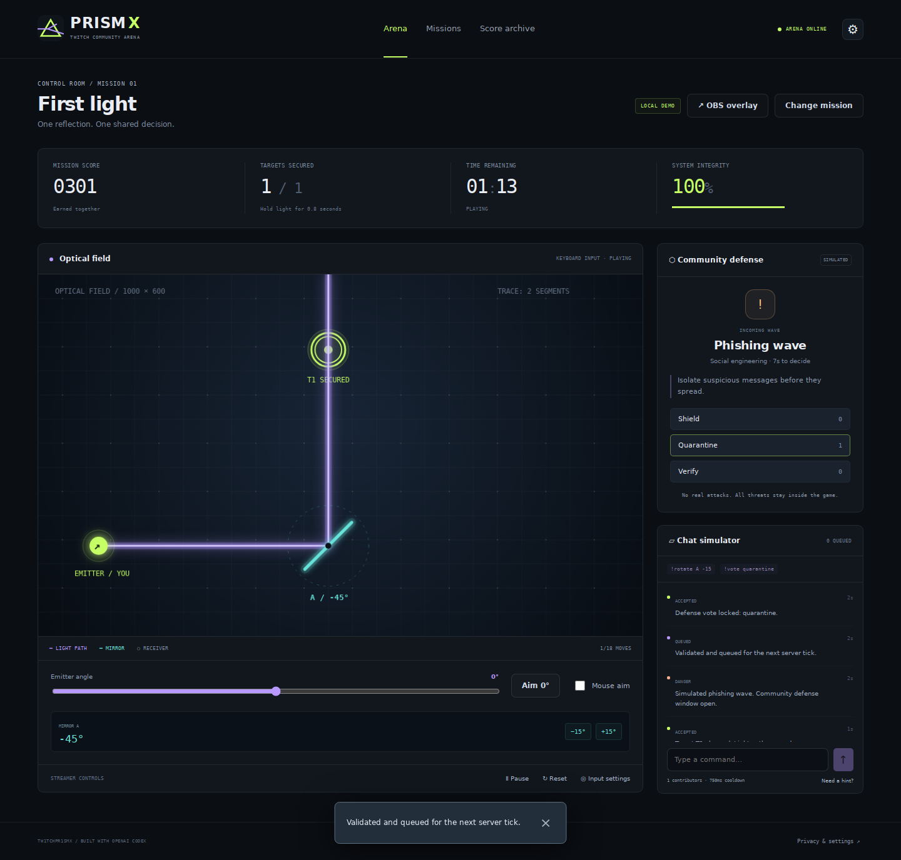

# Tw1tchPr1smX · PRISM X

**Your eyes. Their moves. One mission.** A Twitch community arena where the streamer aims a light beam, chat rotates mirrors, and viewers vote to contain simulated cyber threats. Built with OpenAI Codex for the `Tw1tchCh4tX` repository.



## Run the local demo

Use Node **24.15+ within the 24.x line**, npm, and a modern desktop browser.

```bash
npm ci
cp .env.example .env
npm run dev
```

Open **http://localhost:5173** and choose **Play demo**. No Twitch account, API key, webcam, or paid service is needed. Keep the default loopback binding for this mode. The backend runs on port 3000 and Vite proxies HTTP/WebSocket requests.

For the first mission, disable mouse aim, select **Aim 0°**, send `!rotate A -15`, and vote **quarantine** during the phishing wave. Hold the reflected beam on the target for 0.8 seconds; the round completes after the defense window closes. Each simulated browser operator is one voter, not an unlimited crowd.

## What is implemented

- Deterministic ray/segment intersection, reflection, absorbing obstacles, bounded bounce tracing, and target charging.
- Three playable missions with increasing mirror chains, move budgets, timed waves, wins/losses, scores, and achievements.
- Server-authoritative state, validated commands, replay protection, per-user cooldowns, global token bucket, bounded queues, and read-only WebSocket broadcasts.
- Real Twitch OAuth and EventSub WebSocket adapter for read-only chat from the consenting broadcaster's own channel. Demo and Twitch results stay separate.
- Optional local MediaPipe iris estimation, five-point calibration, smoothing, sensitivity controls, tracking status, immediate stop, and mouse/keyboard fallback.
- A transparent `/overlay` HUD for OBS Browser Sources, with independent HUD/event toggles.
- SQLite persistence for the last 100 anonymous mission results, mode-separated local leaderboards, and authenticated deletion.
- Unit, integration, component, browser and CI harnesses. See [verification status](docs/IMPLEMENTATION_STATUS.md).

This is a single-server, single-arena application. Simulated threats never attack external systems. Eye-gaze input is experimental; live Twitch credentials, real-camera accuracy, native OBS capture, and deployment require the documented acceptance checks.

## Commands and controls

| Input                                           | Action                                               |
| ----------------------------------------------- | ---------------------------------------------------- |
| Mouse over canvas / emitter slider / arrow keys | Aim the light                                        |
| Space while canvas is focused                   | Pause                                                |
| `!rotate A -15`                                 | Rotate mirror A; A–C, nonzero 5° steps, at most ±45° |
| `!vote shield`                                  | Absorb a request burst                               |
| `!vote quarantine`                              | Contain phishing                                     |
| `!vote verify`                                  | Verify a suspicious login                            |
| `!help`, `!hint`, `!status`, `!score`           | Read mission guidance                                |

Votes are final, one per viewer per wave. A unique plurality wins; ties or no votes fail. A defense choice spends one of three charges. All scoring happens on the server.

## Optional integrations

For Twitch, follow [Twitch setup](docs/TWITCH_SETUP.md). Credentials belong only in server configuration. Connect first, then start a new round to enter Twitch mode.

For gaze, run `npm run gaze:assets`, then enable the camera explicitly in settings. The pinned model and WASM are served locally; frames do not leave the browser. Run the asset step before a production build. See [privacy](docs/PRIVACY.md).

For OBS, open **OBS overlay** and copy its URL into a 1920 × 1080 Browser Source. See [OBS setup](docs/OBS_SETUP.md).

## Quality harness

```bash
npx playwright install --with-deps chromium
npm run harness
npm audit
```

The harness runs secret scanning, formatting, lint, strict TypeScript, coverage thresholds, production builds, and real browser journeys. CI runs the same checks with pinned GitHub Action revisions. It does not need Twitch credentials or a camera. [Testing guide](docs/TESTING.md)

## Production

```bash
npm run build
# Configure .env for the actual origin, NODE_ENV=production and a private operator key.
npm start
```

Fastify serves the built frontend, API, OAuth callback, and WebSocket on one origin. [Deployment guide](docs/DEPLOYMENT.md) includes environment variables, container use, reverse proxy requirements, backup/rollback, and the explicit no-deployment-yet status. Static hosting alone cannot run this backend.

## Project map

```text
apps/web/          React interface, Canvas renderer, local gaze
apps/server/       Fastify API, mission engine, security, Twitch, SQLite
packages/physics/  Pure deterministic ray geometry
packages/shared/   Runtime schemas, types and three mission definitions
tests/e2e/         Browser acceptance journeys
scripts/           Pinned gaze assets and source secret checks
docs/              Setup, design, safety, test and release guides
```

Start with [architecture](docs/ARCHITECTURE.md), [gameplay](docs/GAMEPLAY.md), [API](docs/API.md), [security](docs/SECURITY.md), and [contributing](docs/CONTRIBUTING.md). MIT license; third-party components retain their licenses. This project is not affiliated with or endorsed by Twitch or OpenAI.
