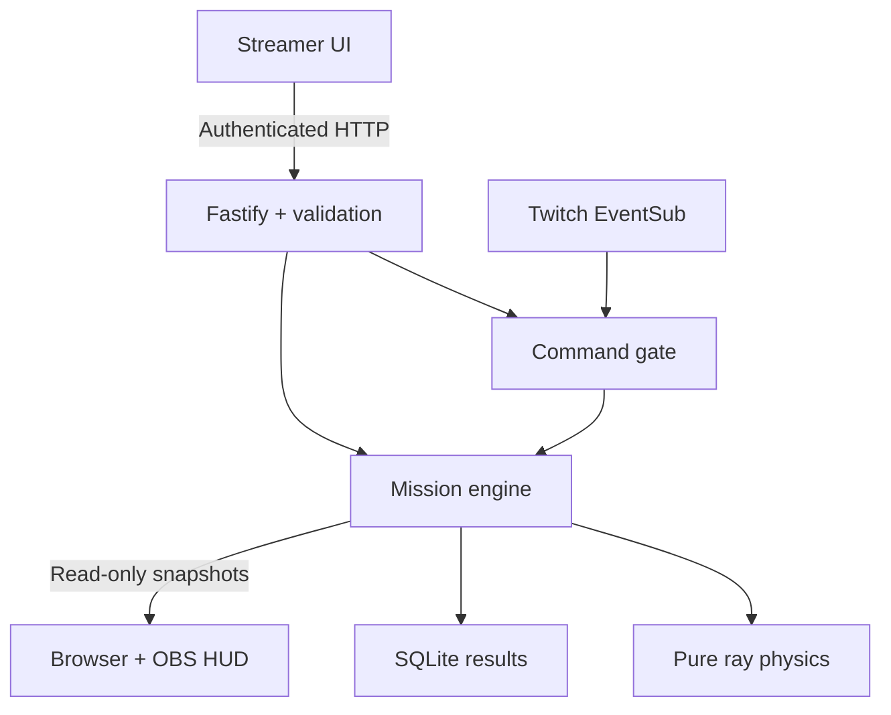

# Architecture

The browser renders server snapshots; it never chooses the authoritative score, phase, mirror geometry, or vote outcome. One Node process owns one shared arena. SQLite survives restarts; the active round, sessions, tokens, and protection caches do not.

`packages/shared` defines runtime Zod schemas and the mission data. `packages/physics` has no I/O or clock. `Game` advances in 50ms logical steps; the server ticks every 100ms and broadcasts at 10Hz. Browser input is throttled separately. Delayed server ticks slow logical game time rather than fast-forwarding wall time; this is unsuitable for competitive timing across hosts.

Chat enters a common allowlist parser and gate from either authenticated demo HTTP or the Twitch adapter. The gate rejects stale/replayed events, caps intake and queue length, and drains eight commands per tick. Reset, pause, resume and mission changes clear queued work; replay memory remains. Each active threat owns one bounded ballot map.

Round completion produces one result. Storage failures emit a visible event and make readiness fail without taking down active play. History has no player identity. Socket clients receive state only, with caps and backpressure handling. Reconnects receive a fresh snapshot, never a replay of control actions.

The local gaze adapter is an optional browser module. It owns camera lifetime, landmark inference, calibration and smoothing; only the resulting emitter angle reaches the server. No OpenAI API key or runtime model call is involved: Codex was used as the implementation tool.

Scale by isolating separate arena processes and databases. Horizontal replicas sharing an arena are not supported. A future multi-tenant service needs durable room ownership, a central limiter, account-level authorization, operational monitoring and a stronger ranking model.
